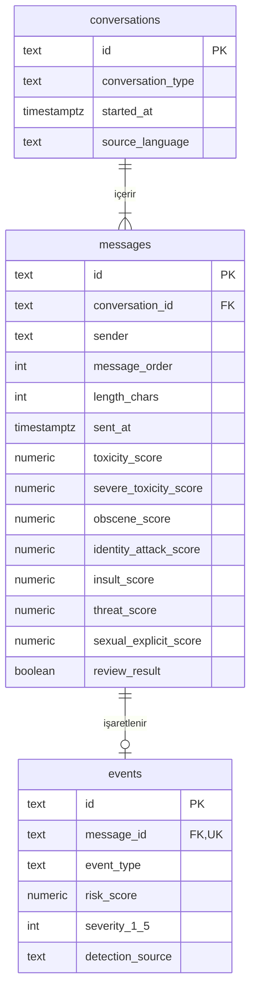

# Kura 8 — Eğitim Sohbet Asistanı Güvenlik ve Olay Takibi

**Ders:** BLP 105 / Veritabanı Yönetim Sistemleri · Güz 2026  
**Kura:** 8 · **Alan:** Eğitim · **Sistem:** Sohbet asistanı · **YZ bileşeni:** Güvenlik ve olay takibi

| Dosya | Amaç |
|---|---|
| `SCENARIO.md` | Problem, ana soru, kullanıcılar ve tablo adayları |
| `data/README.md` | Veri kartı, kaynak, lisans ve temizleme açıklaması |
| `scripts/download_and_prepare.py` | Açık veri kaynağını indirip güvenli/analize hazır dört CSV ve çalıştırma özetini üretir |
| `scripts/01_staging_tables.sql` | CSV içe aktarma için basit yerel hazırlık tabloları (vize değerlendirme çıktısı değildir) |
| `scripts/02_load_csv.psql` | CSV dosyalarını PostgreSQL'e yükler |
| `sql/hafta-04-select.sql` | SELECT ve WHERE örnekleri |
| `sql/hafta-05.sql` | Senaryoya özel en az beş analiz sorgusu |
| `AI_BEYAN.md` | Yapay zekâ kullanım beyanı |
| `reports/rapor.md` | Sınıfta elden verilecek tek sayfalık rapor taslağı |

## 1. Veriyi hazırlama

Gereksinim: Python 3.10 veya üzeri. Ek Python paketi gerekmez; yalnızca Python standart kütüphanesi kullanılır.

Proje klasörünün kök dizininde terminal aç ve çalıştır:

```bash
python scripts/download_and_prepare.py --limit-conversations 800
```

İlk çalıştırmada OpenAssistant'ın orijinal, sıkıştırılmış `ready.messages.jsonl.gz` dosyası `data/raw/` altına indirilir. Ardından İngilizce konuşma ağaçlarından en fazla 800 konuşmalık örnek seçilir ve `data/processed/` altında `conversations.csv`, `conversations_stage.csv`, `messages.csv`, `events.csv` ile `build_summary.json` ve `data_card_run.md` üretilir. **En az 500 farklı konuşma seçilemezse script hata vererek durur; daha az veriyi 500 gibi göstermeye çalışmaz.**

Ham `.gz` dosyası değiştirilmez. Kaynak dosyada serbest metin ve kullanıcı mesajları bulunabildiği için `.gitignore` ile Git'e eklenmesi engellenmiştir. İşlenmiş CSV'lerde mesaj metni veya kullanıcı kimliği yoktur; yalnızca mesaj uzunluğu, rol, zaman ve güvenlik skorları bulunur. Eğitmenin ham dosyanın GitHub'a yüklenmesini özellikle istemesi hâlinde, bunu **özel (private) depo** ve dersin veri-gizliliği kuralları çerçevesinde yap.

Bu çalıştırmada gerçek çıktı özeti `data/processed/data_card_run.md` ve makine tarafından okunabilir `data/processed/build_summary.json` dosyalarında saklanır. CSV çıktıları yeniden üretilebilir ve depoda tutulabilir; ham `.jsonl.gz` ile indirme sırasında oluşan `.part` dosyaları `.gitignore` kapsamındadır.

## 2. PostgreSQL'e yükleme

Önce PostgreSQL'de `egitim_chatbot` adında boş bir veritabanı oluştur. PostgreSQL 18 Windows kurulumunda Git Bash üzerinden örnek komutlar:

```bash
"/c/Program Files/PostgreSQL/18/bin/createdb.exe" -U postgres egitim_chatbot
"/c/Program Files/PostgreSQL/18/bin/psql.exe" -U postgres -d egitim_chatbot -f scripts/01_staging_tables.sql
"/c/Program Files/PostgreSQL/18/bin/psql.exe" -U postgres -d egitim_chatbot -f scripts/02_load_csv.psql
```

`psql` parola sorarsa PostgreSQL kurulumunda belirlediğin parolayı gir. Komutları proje klasörünün kök dizinindeyken çalıştır; `\copy` yolları bu dizine göredir.

Yükleme kontrolü:

```sql
SELECT COUNT(*) FROM conversations;
SELECT COUNT(*) FROM messages;
SELECT COUNT(*) FROM events;
```

`conversations` tablosunda en az 500 satır görmelisin. Sonra:

```bash
"/c/Program Files/PostgreSQL/18/bin/psql.exe" -U postgres -d egitim_chatbot -f sql/hafta-04-select.sql
"/c/Program Files/PostgreSQL/18/bin/psql.exe" -U postgres -d egitim_chatbot -f sql/hafta-05.sql
```

## Veri ve yöntem sınırı

OASST1 genel amaçlı, çok dilli bir sohbet koleksiyonudur; belirli bir dil okulunun veya gerçek bir eğitim platformunun kayıtları değildir. Bu projede yalnızca İngilizce konuşma ağaçları kullanılır. `conversation_type` kök kullanıcı mesajındaki anahtar kelimelerle türetilen yaklaşık bir sınıftır. Güvenlik olayları, kaynakta bulunan Detoxify skorlarının seçilen eşik üzerindeki işaretleridir; **doğrulanmış ihlal anlamına gelmez**. Gerçek üründe insan incelemesi gerekir.

## Veri Modeli

Kaynak: `SCENARIO.md` tablo adayları ve vize verisi (800 konuşma, 8.698 mesaj, 70 olay). Vizedeki üç tablo aday olarak kaldı; bu ödevde ilişkileri, anahtarları ve türetilmiş sütunları gözden geçirip kesinleştirdim.

### 2.1 Güncel ERD



Ek kısıtlar: `messages (conversation_id, message_order)` birlikte tekil; `events.message_id` tekil (bir mesaja en fazla bir olay).

**İlişki cümleleri**

- Bir konuşma (`conversations`), en az bir ve en çok sınırsız sayıda mesaja (`messages`) sahiptir; bir mesaj (`messages`) tam olarak bir konuşmaya (`conversations`) aittir.
- Bir mesaj (`messages`), en az sıfır ve en çok bir olaya (`events`) sahiptir; bir olay (`events`) tam olarak bir mesaja (`messages`) aittir.

Veride doğrulama: 800 konuşmanın hepsinde en az bir mesaj var; 70 olayın 70'i farklı bir mesaja ait; 746 konuşmada hiç olay yok. M-N ilişki yok, bu yüzden ara tablo gerekmedi.

### 2.2 Normalizasyon notu

>
> ### 2.2 Normalizasyon

### 2.2 Normalizasyon

| Tablo | Neden bu şekilde? | İlgili normalizasyon formu |
|---|---|---|
| `conversations` | Her konuşmanın kendine özgü bir `id` değeri vardır. `conversation_type`, `started_at` ve `source_language` gibi bilgiler bu konuşmaya aittir. `message_count` ve `event_count` sütunları konuşma tablosunda tutulmamıştır; çünkü bu değerler diğer tablolardaki kayıtlar sayılarak hesaplanabilir. Tabloda tutulmaları, mesaj veya olay eklendiğinde ya da silindiğinde sayıların güncellenmesini gerektirerek güncelleme anomalilerine yol açabilirdi. | **3NF:** Konuşmaya ait bilgiler doğrudan konuşmanın birincil anahtarı olan `id` değerine bağlıdır. Başka bir anahtar olmayan sütuna bağlı ek bilgi tutulmaz. |
| `messages` | Her mesajın kendine özgü bir `id` değeri vardır. Ayrıca `(conversation_id, message_order)` ikilisi benzersizdir. Mesajın sırası ve içeriğe ait özellikleri bu kayıt üzerinden belirlenir. Konuşmanın türü gibi konuşmaya ait bilgiler mesaj tablosunda tekrar tutulmaz. | **2NF:** `(conversation_id, message_order)` birleşik benzersiz anahtardır. `conversation_type` yalnızca `conversation_id` alanına bağlıdır; birleşik anahtarın tamamına bağlı değildir. Bu nedenle `conversation_type` mesaj tablosunda tutulsaydı kısmi bağımlılık oluşurdu. Bu bilgi `conversations` tablosunda tutulur. |
| `events` | Her olayın kendine özgü bir `id` değeri vardır. `message_id` ile olayın hangi mesaja ait olduğu belirlenir. `event_type`, `risk_score` ve `severity_1_5` gibi bilgiler olayın özellikleridir. `conversation_id` alanı, mesaj üzerinden konuşmaya ulaşılabildiği için olay tablosunda ayrıca tutulmaz. `severity_1_5` alanı ise README'de açıklanan bilinçli normalizasyon istisnası kapsamında değerlendirilir. | **3NF:** `events.id → message_id → conversation_id` şeklinde geçişli bağımlılık oluşabileceğinden `conversation_id` olay tablosunda tekrar tutulmaz. Konuşma bilgisine `message_id` üzerinden ulaşılır. `severity_1_5` alanı ise README'de belirtilen bilinçli istisnadır. |

**Üç normalizasyon formuna kendi tablolarımızdan örnekler:**

- **1NF (Birinci Normal Form) – `messages`:** `toxicity_score` sütununda her mesaj için yalnızca bir sayısal değer tutulur. Bir hücrede birden fazla skor bulunmadığı için 1NF sağlanır.
- **2NF (İkinci Normal Form) – `messages`:** `(conversation_id, message_order)` birleşik benzersiz anahtardır. `conversation_type` yalnızca `conversation_id` alanına bağlı olduğundan mesaj tablosunda tutulması kısmi bağımlılık yaratırdı. Bu nedenle `conversation_type`, `conversations` tablosunda tutulur.
- **3NF (Üçüncü Normal Form) – `events`:** `events.id` olayın `message_id` değerini belirler; `message_id` ise mesajın `conversation_id` değerini belirler. Böylece `events.id → message_id → conversation_id` geçişli bağımlılığı oluşur. Bu nedenle `conversation_id` `events` tablosundan çıkarılır ve konuşma bilgisine `messages` üzerinden ulaşılır.


### 2.3 İki JOIN sorusu
>
- **Soru 1 (INNER JOIN):**  Güvenlik olayı olarak işaretlenen mesajları ve bu mesajların olay türlerini listelemek için messages ve events tabloları nasıl birleştirilmelidir? Birleşme koşulu messages.id = events.message_id olmalıdır. Yalnızca güvenlik olayı bulunan mesajları listelemek istediğimiz için INNER JOIN kullanılmalıdır.

- **Soru 2 (LEFT JOIN):** Hiç güvenlik olayı bulunmayan konuşmalar da dahil olmak üzere tüm konuşmaları, mesajlarını ve varsa bu mesajlara ait güvenlik olaylarını listelemek için conversations, messages ve events tabloları nasıl birleştirilmelidir? İlk birleşme conversations.id = messages.conversation_id, ikinci birleşme ise messages.id = events.message_id koşuluyla yapılmalıdır. Tüm konuşmaların ve mesajların sonuçlarda kalmasını istediğimiz için LEFT JOIN kullanılmalıdır. INNER JOIN kullanılsaydı güvenlik olayı bulunmayan mesajlar ve bunların ait olduğu konuşmalar sonuçlardan elenebilirdi.