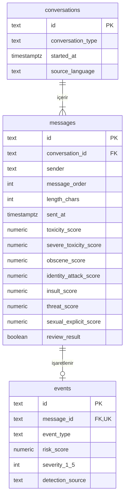

# Kura 8 — Eğitim Sohbet Asistanı Güvenlik ve Olay Takibi

**Ders:** BLP 105 / Veritabanı Yönetim Sistemleri · Güz 2026  
**Kura:** 8 · **Alan:** Eğitim · **Sistem:** Sohbet asistanı · **YZ bileşeni:** Güvenlik ve olay takibi

| Dosya | Amaç |
|---|---|
| `SCENARIO.md` | Problem, ana soru, kullanıcılar ve tablo adayları |
| `data/README.md` | Veri kartı, kaynak, lisans ve temizleme açıklaması |
| `scripts/download_and_prepare.py` | Açık veri kaynağını indirip güvenli/analize hazır dört CSV ve çalıştırma özetini üretir |
| `scripts/01_staging_tables.sql` | CSV içe aktarma için basit yerel hazırlık tabloları (vize değerlendirme çıktısı değildir) |
| `scripts/02_load_csv.psql` | CSV dosyalarını PostgreSQL'e yükler |
| `sql/hafta-04-select.sql` | SELECT ve WHERE örnekleri |
| `sql/hafta-05.sql` | Senaryoya özel en az beş analiz sorgusu |
| `AI_BEYAN.md` | Yapay zekâ kullanım beyanı |
| `reports/rapor.md` | Sınıfta elden verilecek tek sayfalık rapor taslağı |

## 1. Veriyi hazırlama

Gereksinim: Python 3.10 veya üzeri. Ek Python paketi gerekmez; yalnızca Python standart kütüphanesi kullanılır.

Proje klasörünün kök dizininde terminal aç ve çalıştır:

```bash
python scripts/download_and_prepare.py --limit-conversations 800
```

İlk çalıştırmada OpenAssistant'ın orijinal, sıkıştırılmış `ready.messages.jsonl.gz` dosyası `data/raw/` altına indirilir. Ardından İngilizce konuşma ağaçlarından en fazla 800 konuşmalık örnek seçilir ve `data/processed/` altında `conversations.csv`, `conversations_stage.csv`, `messages.csv`, `events.csv` ile `build_summary.json` ve `data_card_run.md` üretilir. **En az 500 farklı konuşma seçilemezse script hata vererek durur; daha az veriyi 500 gibi göstermeye çalışmaz.**

Ham `.gz` dosyası değiştirilmez. Kaynak dosyada serbest metin ve kullanıcı mesajları bulunabildiği için `.gitignore` ile Git'e eklenmesi engellenmiştir. İşlenmiş CSV'lerde mesaj metni veya kullanıcı kimliği yoktur; yalnızca mesaj uzunluğu, rol, zaman ve güvenlik skorları bulunur. Eğitmenin ham dosyanın GitHub'a yüklenmesini özellikle istemesi hâlinde, bunu **özel (private) depo** ve dersin veri-gizliliği kuralları çerçevesinde yap.

Bu çalıştırmada gerçek çıktı özeti `data/processed/data_card_run.md` ve makine tarafından okunabilir `data/processed/build_summary.json` dosyalarında saklanır. CSV çıktıları yeniden üretilebilir ve depoda tutulabilir; ham `.jsonl.gz` ile indirme sırasında oluşan `.part` dosyaları `.gitignore` kapsamındadır.

## 2. PostgreSQL'e yükleme

Önce PostgreSQL'de `egitim_chatbot` adında boş bir veritabanı oluştur. PostgreSQL 18 Windows kurulumunda Git Bash üzerinden örnek komutlar:

```bash
"/c/Program Files/PostgreSQL/18/bin/createdb.exe" -U postgres egitim_chatbot
"/c/Program Files/PostgreSQL/18/bin/psql.exe" -U postgres -d egitim_chatbot -f scripts/01_staging_tables.sql
"/c/Program Files/PostgreSQL/18/bin/psql.exe" -U postgres -d egitim_chatbot -f scripts/02_load_csv.psql
```

`psql` parola sorarsa PostgreSQL kurulumunda belirlediğin parolayı gir. Komutları proje klasörünün kök dizinindeyken çalıştır; `\copy` yolları bu dizine göredir.

Yükleme kontrolü:

```sql
SELECT COUNT(*) FROM conversations;
SELECT COUNT(*) FROM messages;
SELECT COUNT(*) FROM events;
```

`conversations` tablosunda en az 500 satır görmelisin. Sonra:

```bash
"/c/Program Files/PostgreSQL/18/bin/psql.exe" -U postgres -d egitim_chatbot -f sql/hafta-04-select.sql
"/c/Program Files/PostgreSQL/18/bin/psql.exe" -U postgres -d egitim_chatbot -f sql/hafta-05.sql
```


## Veri ve yöntem sınırı

OASST1 genel amaçlı, çok dilli bir sohbet koleksiyonudur; belirli bir dil okulunun veya gerçek bir eğitim platformunun kayıtları değildir. Bu projede yalnızca İngilizce konuşma ağaçları kullanılır. `conversation_type` kök kullanıcı mesajındaki anahtar kelimelerle türetilen yaklaşık bir sınıftır. Güvenlik olayları, kaynakta bulunan Detoxify skorlarının seçilen eşik üzerindeki işaretleridir; **doğrulanmış ihlal anlamına gelmez**. Gerçek üründe insan incelemesi gerekir.

## Veri Modeli

Kaynak: `SCENARIO.md` tablo adayları ve vize verisi (800 konuşma, 8.698 mesaj, 70 olay). Vizedeki üç tablo aday olarak kaldı; bu ödevde ilişkileri, anahtarları ve türetilmiş sütunları gözden geçirip kesinleştirdim.

### 2.1 Güncel ERD



Ek kısıtlar: `messages (conversation_id, message_order)` birlikte tekil; `events.message_id` tekil (bir mesaja en fazla bir olay).

**İlişki cümleleri**

1. Bir konuşma (`conversations`) en az bir, en çok sınırsız sayıda mesaj (`messages`) içerir; bir mesaj tam olarak bir konuşmaya aittir. (1-N, mesaj tarafı zorunlu, konuşma tarafı zorunlu.)
2. Bir mesaj (`messages`) en fazla bir olay (`events`) ile işaretlenir; bir olay tam olarak bir mesaja aittir. (1-0..1, olay tarafı isteğe bağlı, mesaj tarafı zorunlu.)

Veride doğrulama: 800 konuşmanın hepsinde en az bir mesaj var; 70 olayın 70'i farklı bir mesaja ait; 746 konuşmada hiç olay yok. M-N ilişki yok, bu yüzden ara tablo gerekmedi.

### 2.2 Normalizasyon notu

| Tablo | Neden böyle? (hangi sütun hangisini belirliyor) | Form |
|---|---|---|
| `conversations` | `id` → `conversation_type`, `started_at`, `source_language`. Bu bilgiler konuşmaya ait, mesaja değil; her mesaja kopyalanmasın diye ayrı tablo. `message_count` ve `event_count` çıkarıldı: mesaj/olay satırlarından hesaplanabilir, saklarsak her yeni mesajda iki yeri güncellemek gerekir. | 3NF |
| `messages` | `id` → konuşma, gönderen, sıra, uzunluk, zaman, yedi skor, `review_result`; hepsi doğrudan mesajı anlatır. Skorlar ayrı tabloya alınmadı: her mesajda aynı yedi kategori var ve sayı sabit. Kategori sayısı değişirse `message_scores(message_id, category, score)` ayrılır. `conversation_type` ve `sender` için ayrı tablo açılmadı: 5 ve 2 değer, ek özniteliği yok. | 3NF |
| `events` | `id` → `message_id`, `event_type`, `risk_score`, `severity_1_5`, `detection_source`. `conversation_id`, `message_order`, `detected_at` çıkarıldı: `message_id` bunları zaten belirliyor (veride 70/70 aynı). `severity_1_5`, `risk_score` aralığından kural ile türetilir; katı 3NF'de geçişli bağımlılıktır, ancak insan incelemesi için işaret anındaki şiddeti saklamak istediğimden bilinçli istisna olarak tuttum. | 3NF (tek istisna: `severity_1_5`) |

**Üç form için somut örnek**

- **1NF:** `messages` tablosunda her hücrede tek değer var (ör. `toxicity_score` tek sayı). Yedi skoru tek hücrede `"0.1;0.0;0.3;..."` biçiminde tutsaydım 1NF bozulurdu.
- **2NF:** `(conversation_id, message_order)` mesajın doğal bileşik anahtarıdır. `conversation_type` `messages`'a konsaydı yalnızca `conversation_id`'ye bağlı olurdu (kısmi bağımlılık, 2NF ihlali); bu yüzden `conversations`'ta duruyor. `sender` ve `length_chars` ise anahtarın tamamına bağlı.
- **3NF:** `events.conversation_id` için `id → message_id → conversation_id` zinciri vardı (geçişli bağımlılık). Sütunu kaldırdım; konuşma, `messages` üzerinden bulunur.

### 2.3 İki JOIN sorusu

**Soru 1 (INNER JOIN):** Olayla işaretlenen mesajlar hangi konuşma türünde ve konuşmanın kaçıncı mesajında ortaya çıkmış?

- Birleşme: `events.message_id = messages.id` ve `messages.conversation_id = conversations.id`
- Tür: `INNER JOIN`. Yalnızca üç tabloda da karşılığı olan satırlar lazım; olayı olmayan mesajlar ve mesajı olmayan konuşma bu soruda ilgi alanı dışında.

**Soru 2 (LEFT JOIN, eşleşmeyen kayıt):** Hiç olay kaydı olmayan asistan mesajları hangileri?

- Birleşme: `messages.id = events.message_id`
- Tür: `LEFT JOIN` (`messages` solda). Sol taraftaki bütün mesajlar korunmalı; olayı olmayanlar sağ tarafta `NULL` gelir, `events.id IS NULL` ile süzülür. `INNER JOIN` olsaydı tam da aranan satırlar elenirdi.
